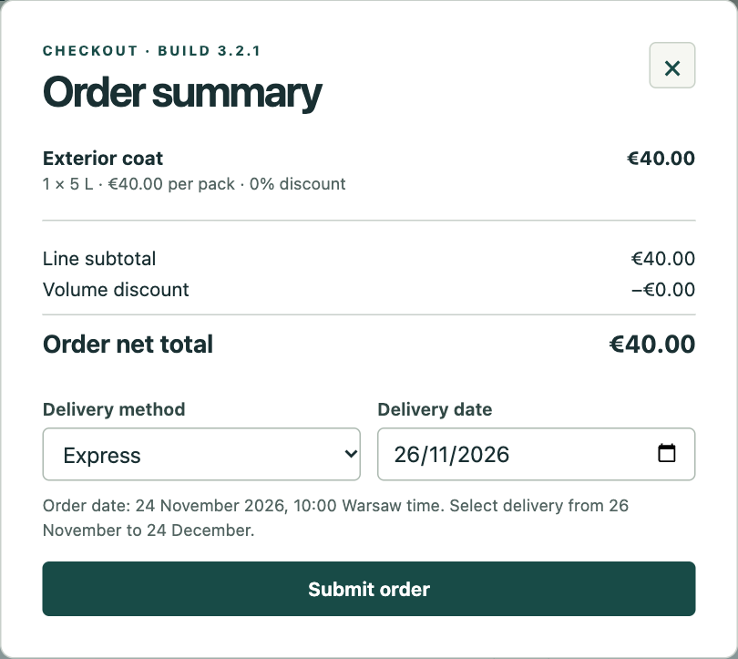
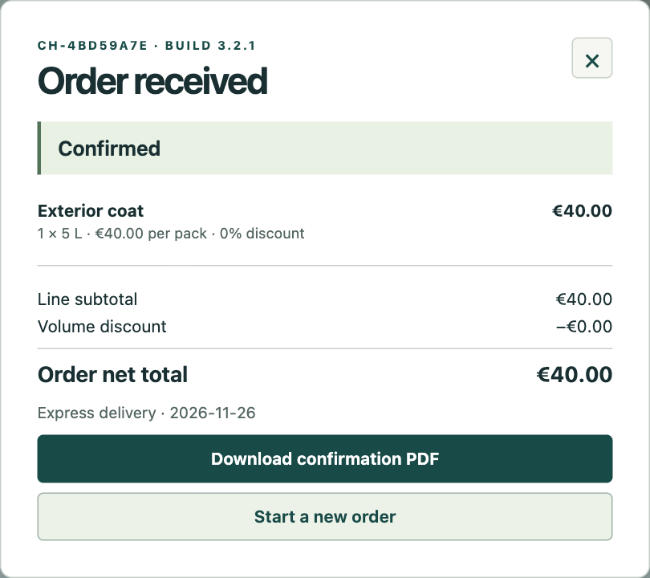

# Manual QA with the GitHub Copilot app

In three exercises you will investigate a pricing complaint, choose regression tests for a release and improve a reviewer that drafts test reports. Complete all three exercises on your own computer using your copy of ColourHub, a fictional paint shop. Save your own results before each whole-group discussion. You can volunteer a finding or ask a question at 10:27–10:30, 14:10–14:15 and 17:52–18:00.

## Set up your local workshop

You need the standalone GitHub Copilot app with access to a model, a browser and a text editor. Git lets you clone the repository and commit your work locally. The shop opens directly from its HTML file. Before the 09:30 exercise, sign in to Copilot and check that you can choose a model. In VS Code, open **Terminal → New Terminal**, type `git --version` and run the commands below. Without Git, use the ZIP option below. Node.js and npm are optional for the trainer’s installer demonstration and engine tests.

```sh
git clone https://github.com/neverased/qa-ai-training.git
cd qa-ai-training
git switch -c workshop-day2
```

1. Open the standalone **GitHub Copilot** app and sign in with the account approved for the workshop. Open the command menu (⌘K on the workshop Mac), type **Add repository** and press Enter. Choose **Local folder or repository…**, select your `qa-ai-training` clone and open it. Start a new session (⌘N on Mac), choose **qa-ai-training** and press Enter. If the app asks whether to trust the folder, inspect the repository and [the workshop connector configuration](.github/mcp.json) first. Choose **Always trust** if the prompt offers it and this is the training clone you reviewed.
2. Below the message box, check **This computer**. Open **Workspace** (initially **New worktree** in the rehearsal) and choose **Current checkout**. Check the local folder name and, for a Git clone, the **workshop-day2** branch so Copilot reads the files you edit. Select a named model and keep it for each comparison. The rehearsal used **Claude Sonnet 5.5** with **Medium** effort. Use `@` in the message box to select each named file, or use `/attach-files`. Check the filenames before sending. For a named reviewer, type `/agent` in the message box, choose **Risk coordinator** or **Ticket reviewer**, and confirm your choice. In the standalone app you can open a new session for each independent test.
3. In Finder or File Explorer open **shop/index.html** in a browser. Set **Build** to **3.2.0** and **Role** to **Buyer**. **Reset cart** starts a fresh order. Keep the browser and the Copilot app visible. Use a text editor such as VS Code to save your observations and edit your local agent file.
4. Attach `inputs/product-rules.md` and try prompt 2. Expand the file-read activity and check that Copilot opened that exact file. Open it in your editor and match its words to the answer. The repo contains three builds of the same fictional shop. The build selector changes the behaviour of the shop while the shared rules describe the expectation.

If cloning is unavailable, use **Code → Download ZIP** on GitHub, extract the archive, then select the extracted root folder in the app. With the extracted folder, skip the branch and commit commands. Before editing the reviewer in exercise 3, copy its original profile outside the project. Keep the revised profile in the project and save your comparison in `outputs/agent-comparison.md`. The shop works offline. The Copilot conversations use a network connection.

[Open the workshop prompts](WORKSHOP_PROMPTS.md) to copy them into Copilot. [Download the six-page desk reference (PDF)](handouts/Participant_Quick_Reference_Day2_v3.pdf) for the worksheets. Print it on A4, double-sided, flipping on the long edge (three sheets per person). You can also [download the editable Word version](handouts/Participant_Quick_Reference_Day2_v3.docx).

### Where to find Express delivery and the confirmation PDF

Open `shop/index.html` in a browser from your clone or fully extracted ZIP. The first screen is **Trade order desk**. If you see HTML source on github.com, open the local file from Finder or File Explorer.

1. Select build **3.2.1** and role **Buyer**. Start with an empty cart. Choose **Exterior coat**, **5 L**, quantity **1**, then **Add to cart**.
2. In **Your cart**, choose **Review order**. On **Order summary**, open **Delivery method** below the net total. Change **Standard** to **Express**.
3. Choose **Submit order**. On **Order received**, this €40 order shows **Confirmed**. Choose **Download confirmation PDF**. Orders marked **Awaiting approval** have no download button.

<details>
<summary>Show the two checkout screens</summary>





</details>

## Exercise 1 — Reproduce a discount report

1. Read [the urgent order story](inputs/urgent-order-story.md) and [the rules](inputs/product-rules.md). Ask Copilot which two details need a decision from the product owner. Match its quotations to the two files. Choose one of the two questions to ask the product owner.
2. In 3.2.0 as Buyer, add **Exterior coat, 5 L**. Test **199, 200 and 201** on separate orders or update the existing line. Record the build, item, displayed rate and total in [your evidence](outputs/evidence.md). At **200 packs**, read the rate on the cart line, save `outputs/cart-200.png`, and open the evidence link `[200-pack cart](cart-200.png)` before changing the quantity to 201.
3. Use prompt 4 with your evidence and the rules. Recalculate the expected totals and match every reported difference to a cart reading. With prompt 5, request the three drafts in chat and decide which text to transfer yourself. Use [the three practice reports](inputs/raw-notes.md) and [the queue guide](inputs/gcss-training.md) to fill in [your issue report](outputs/report.md). Check the reporting activity, queue, observer, expected and actual result, and missing evidence for each draft. Link the sprint report to your own capture.
4. Open a **new local session** for prompt 6. If a **Ticket reviewer** or **Risk coordinator** chip appears above your prompt, click its **×** and confirm **Default agent**. The app can retain the previous agent when you start a new session. The training reviewer is limited to local files.
5. Use prompt 6 to read [the public training issue](https://github.com/neverased/qa-ai-training/issues/1) with the project’s **Workshop Issues** connector. Expand **Workshop Issues · Get issue details**. Check the repository, issue number and response body. Compare its words with [the local copy](inputs/ticket-no-observation.md). Record whether anyone actually saw a price and the source of that conclusion. Leave Actual result blank in a report sourced only from issue #1. Keep what you personally measured in your evidence and sprint report. Reset the cart on 3.2.0. Repeat the 200-pack check from the steps in your saved sprint report. Open its linked PNG and compare the rate and total with your new reading. Record what matched and correct any unclear step.

**If the issue tool is missing.** Open [the project configuration](.github/mcp.json) and check for `workshop-issues`. It connects to GitHub’s hosted read-only service and allows the single `issue_read` tool. Return to the current checkout in the desktop app, start a new session, clear any reviewer chip and retry prompt 6. If your account asks for sign-in, follow your organisation’s approved process. If access is unavailable, open the public issue in your browser and label that evidence **browser**. A local file, a `gh issue view` command and a connector call have different sources; record the one you used.

## Exercise 2 — Choose the regression that fits 45 minutes

1. Select **3.2.1**. Repeat the earlier boundary check using the same product, size and role. Record the actual cart and order-summary amounts separately.
2. For the separate Express shipping report, use prompt 9 to compare two possible causes. Record the evidence and next investigation in [your report](outputs/report.md). Return to pricing for the release plan. Attach [the release note](inputs/pricing-change.md), [rules](inputs/product-rules.md) and [case catalogue](inputs/regression.csv). Write your own shortlist, then use prompt 10 for a second opinion in chat. If a question card appears, read the proposed choices and reply to any open question. Check the local diff before transferring your final selection. Record the unique check names, their minutes, the remaining time and one deferred risk in [your regression plan](outputs/regression.md).
3. In the ten-minute execution slot run **one** check. The cart/summary comparison takes an estimated 6 minutes; the 50-pack confirmation PDF takes 8. Record actual elapsed time and the observation in your regression plan.
4. In a new chat choose **Risk coordinator**. Ask it to delegate to **Impact reviewer** and **Coverage reviewer** independently. Open both worker activities and verify their names, inputs and returned findings. If the parent handled the work alone, record that as a single review. If your client lacks delegation, use two separate chats and record that method. Compare the coordinator’s and catalogue-only proposals using [the worked example](WORKSHOP_PROMPTS.md#13-two-workers-review-the-same-release), then record a deferred risk and release recommendation.
5. Close the Copilot conversation and reopen [your saved plan](outputs/regression.md). Follow one row exactly as written. In [your review](outputs/review.md), score the original plan on all five criteria from 0 to 2 and cite a row for each score. Record a before-and-after version of the least clear step.
6. For the seven-row comparison, open two independent **Default agent** chats with the same named model. Attach [the product rules](inputs/product-rules.md) and [the seven claims](inputs/review-fixtures.csv) to each. Run prompts A and B separately. Save the complete replies first. When the trainer reveals the key, score the distinct named rows in your own responses.

## Exercise 3 — Improve an agent and reuse a prompt

1. In a fresh chat choose **Ticket reviewer**. Name only [the request without a run](inputs/ticket-no-observation.md) and the rules in your prompt. Use the same prompt, model and file paths for the before-and-after runs. Check the activity for any extra file reads. Repeat a run that used other evidence.
   > Read only inputs/ticket-no-observation.md and inputs/product-rules.md. Draft a manual test report. Give the expected result, actual result, supporting evidence and your next question for the tester. Reply in chat only. Leave all files unchanged.
2. Save the verbatim actual-result field and the model in [your comparison](outputs/agent-comparison.md). Add this rule to [.github/agents/ticket-reviewer.agent.md](.github/agents/ticket-reviewer.agent.md): “Fill in Actual result only when the ticket includes an observation from a test run. Otherwise leave it empty and ask for the evidence.” Open a new chat and select the updated profile. Repeat with identical paths, model and wording.
3. Repeat with [the observed ticket](inputs/ticket-with-observation.md). For a final control, create `inputs/ticket-future-check.md` containing only “Expect a 10% discount on 200 packs. The test is scheduled for tomorrow.” In each control prompt, change only the ticket path. Compare the outcomes. Score evidence and formatting separately. A field saying “not recorded” contains no invented price, but still contains text. Record a tie if both profiles meet the same criterion. With Git, review the diff and commit your experiment and evidence **locally**. With the ZIP, compare your saved original profile with the revised file and record the differences in your comparison. Record a recommendation for the shared agent’s owner. “Empty.” is also text in the field.
   ```sh
   git diff -- .github/agents/ticket-reviewer.agent.md
   git add -- .github/agents/ticket-reviewer.agent.md outputs/agent-comparison.md
   git diff --cached
   git commit -m "Test an evidence rule for ticket reports"
   ```
4. If a shared agent is managed by another team, use [the draft review prompt](WORKSHOP_PROMPTS.md#22-review-a-draft-when-the-shared-agent-is-managed-by-its-owner) with its draft and the source ticket. The owner can use your comparison to decide whether to adopt the rule.
5. Follow [the skill authoring instructions](.github/skills/README.md) to create `.github/skills/review-regression/SKILL.md`. In a fresh Default agent project chat invoke `/review-regression` with the pricing note, product rules and catalogue. Open the activity to confirm the skill ran. If it asks a question, answer it and check the revised shortlist. Recalculate the minutes. Check the review question you added and refine it if the pricing run exposed a gap. Save your changes before switching to the tint change.
6. Switch the shop to **3.3.0**. Read [the tint change](inputs/tint-change.md). Compare a new order with a saved untinted draft reopened and edited to add the same tint. For both paths use 20 × 1 L and 3 × 5 L Exterior coat. Tint the 1 L line with **CH-1180-02**. On the second route, choose **Saved drafts → Open draft** before adding the tint. Submit each separately. Save a PNG for each status and link both in [your release handover](outputs/handover.md).
7. Run your revised skill on the tint change in a fresh **Default agent** chat. Use [prompt 26](WORKSHOP_PROMPTS.md#26-can-your-skill-review-a-different-change) with only the change, product rules and catalogue. Save the complete first reply. Check a claimed gap against a named catalogue row before trying the optional hint. Finish your release handover with the observed impact and next action before the final discussion.

## Optional commands

During the optional trainer demonstration, the trainer uses Node.js and npm to inspect Matt Pocock’s skills and install a selected skill in the training project. Your exercise uses the local skill you built. For reference, the project commands are below. Review the source of [diagnosing-bugs](https://github.com/mattpocock/skills/tree/main/skills/engineering/diagnosing-bugs) first.

```sh
npx skills add mattpocock/skills --list
npx skills add mattpocock/skills --skill diagnosing-bugs -a github-copilot
npx skills list -a github-copilot
```

To check the training engine using Node.js, run `node --test tests/engine.test.js`. These are the maintainer’s fixture tests. Do your manual runs before looking at their assertions. The training releases deliberately behave differently.

Keep your notes in the six Markdown templates under `outputs/` and your screenshots alongside them. Keep real tickets, company documents, customer identifiers and private screenshots in your organisation’s own systems.

[GitHub guide to the desktop app](https://docs.github.com/en/copilot/get-started/quickstart-copilot-app) · [Local sessions and workspaces](https://docs.github.com/en/copilot/how-tos/github-copilot-app/agent-sessions) · [Custom agents and skills](https://docs.github.com/en/copilot/how-tos/github-copilot-app/customize-github-copilot-app)

[GitHub’s remote MCP server and its tool filters](https://github.com/github/github-mcp-server/blob/main/docs/remote-server.md) · [MCP in the GitHub Copilot app](https://docs.github.com/en/copilot/concepts/customizations/mcp)
